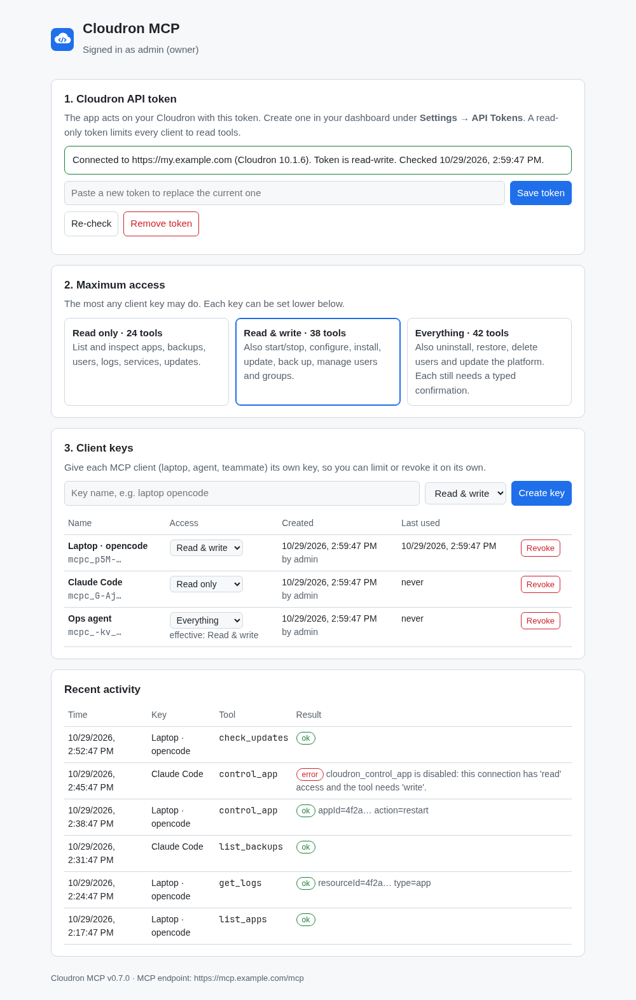

# mcp-cloudron

MCP server for [Cloudron](https://cloudron.io/) instance management: apps, backups, users, services, logs, the event log and platform updates, plus helpers for packaging apps.

Forked from [halecraft/mcp-cloudron](https://github.com/halecraft/mcp-cloudron) 0.5.0. This fork targets **Cloudron 9.0 and 10.x**, fixes the endpoints that no longer exist, and adds an access model so an agent can only do what you allow. See [CHANGELOG.md](CHANGELOG.md).

There are two ways to run it:

- **As a Cloudron app** (below): one install on your Cloudron, a settings page, and a key per client. Clients connect over HTTPS from anywhere.
- **As a local server** over stdio, configured with environment variables. See [Running it locally](#running-it-locally).

## Cloudron app



Requires Cloudron 10. In the dashboard, open the App Store, choose **Add custom app → Community app**, and paste:

```
https://raw.githubusercontent.com/mattstyles333/mcp-cloudron/main/CloudronVersions.json
```

Then open the app:

1. **Cloudron API token.** Create one under **Settings → API Tokens** and paste it in. The app checks it with Cloudron and reports whether it is read-only or read-write.
2. **Maximum access.** Choose the most any client may do: read only, read & write (default), or everything. Everything includes the destructive tools.
3. **Client keys.** Create one per client (laptop, agent, teammate), each with its own access level. A key is shown once; the page gives ready-made setup for Claude Code and opencode:

   ```shell
   claude mcp add --transport http cloudron https://mcp.example.com/mcp \
     --header "Authorization: Bearer mcpc_..."
   ```

**What a client may do** is the lowest of: its key's level, the maximum access level, and what the API token allows. A read-only token keeps every client read-only.

**Who may change settings:**

- The settings page is behind the Cloudron login.
- Once a working token is saved, only Cloudron owners and admins can manage the app; the app checks the signed-in user's role with Cloudron.
- Before that, anyone allowed into the app can set it up, so restrict the app to admins in its Access Control settings if other users can reach it.
- If Cloudron later rejects the stored token, setup reopens so it can be replaced. A replacement token only carries its owner's own rights.

**Other details:**

- Recent tool calls are listed with the key that made them. Only IDs and names are logged, never env values or passwords.
- Keys are stored as SHA-256 hashes. The API token is stored in the app's data directory, so it is part of the app's backups; encrypt your backup site.
- The MCP endpoint is stateless Streamable HTTP at `/mcp`. OAuth sign-in for clients is not supported yet, so clients must send a bearer key; that rules out claude.ai custom connectors for now.

## Safety model

Three layers, from strongest to weakest:

1. **The API token.** Cloudron tokens are read-only or read-write. A read-only token can only make GET requests, whatever this server does. Use one unless you need writes.
2. **`CLOUDRON_ACCESS`** decides which tools the server offers at all:

   | Level | Tools | Use with |
   |---|---|---|
   | `read` (default) | 24 read-only tools + packaging helpers | read-only token |
   | `write` | adds tools that change state but can be undone or redone: start/stop/restart, configure, install, clone, repair, update app, backups, create/update users and groups, restart service, stop task | read-write token |
   | `all` | adds destructive tools: uninstall app, restore app, delete user, apply platform update | read-write token |

   Hidden tools are also refused if called by name.
3. **Confirmation arguments.** Destructive tools make the caller repeat the target's human-readable name: `confirm` must equal the app's fqdn (uninstall, restore) or the user's email (delete user). `cloudron_apply_update` needs the exact pending version. A wrong or stale ID therefore fails instead of hitting the wrong app.

Every tool also carries MCP annotations (`readOnlyHint`, `destructiveHint`, `idempotentHint`), so clients can ask for approval on writes.

Pre-flight checks run before risky operations: the backup belongs to the app being restored, the clone target is free, the last owner cannot be deleted, an uninstalled app has a recent backup (warning), and the root disk is not critically full.

## Configuration (local server)

| Variable | Required | Description |
|---|---|---|
| `CLOUDRON_BASE_URL` | yes | Dashboard URL, e.g. `https://my.example.com`. Must be `https://` (plain http only for localhost). |
| `CLOUDRON_API_TOKEN` | yes | API token from **Settings → API Tokens** in the dashboard. |
| `CLOUDRON_ACCESS` | no | `read` (default), `write` or `all`. |

An API token acts with the role it was created with (Cloudron 10 defaults to **admin**). With an admin token, Cloudron refuses owner-only actions such as creating owners or installing apps that use the docker addon.

## Running it locally

```shell
pnpm install
pnpm build
```

### opencode

```json
{
  "mcp": {
    "cloudron": {
      "type": "local",
      "command": ["node", "/path/to/mcp-cloudron/dist/server.js"],
      "environment": {
        "CLOUDRON_BASE_URL": "https://my.example.com",
        "CLOUDRON_API_TOKEN": "{env:CLOUDRON_API_TOKEN}",
        "CLOUDRON_ACCESS": "read"
      }
    }
  }
}
```

### Claude Desktop / Claude Code

```json
{
  "mcpServers": {
    "cloudron": {
      "command": "node",
      "args": ["/path/to/mcp-cloudron/dist/server.js"],
      "env": {
        "CLOUDRON_BASE_URL": "https://my.example.com",
        "CLOUDRON_API_TOKEN": "your-api-token",
        "CLOUDRON_ACCESS": "read"
      }
    }
  }
}
```

Keep the token out of config files you commit; load it from the environment where your client supports that.

## Tools

**Read** (always available)

| Tool | What it does |
|---|---|
| `cloudron_get_status` | Version, server, uptime, reboot required, pending platform update |
| `cloudron_list_apps` / `cloudron_get_app` | Apps with state, health, errors and pending updates. Env values are hidden. |
| `cloudron_list_app_backups` | One app's backups, newest first |
| `cloudron_list_backups` / `cloudron_list_backup_sites` | Full backups and backup destinations |
| `cloudron_get_logs` | Recent log lines of an app, platform service or task |
| `cloudron_list_services` | Platform services with status and memory |
| `cloudron_list_eventlog` | Audit log, filterable by app, action, text and date |
| `cloudron_list_notifications` | Dashboard notifications (failed backups, app errors...) |
| `cloudron_task_status` | Progress of an async task |
| `cloudron_check_storage` | Free space on the root disk |
| `cloudron_list_domains` | Configured domains |
| `cloudron_list_users` / `cloudron_get_user` / `cloudron_list_groups` | Users and groups |
| `cloudron_search_apps` / `cloudron_validate_manifest` | App Store search and pre-install check |
| `cloudron_check_updates` | Pending platform update and changelog |
| `cloudron_validate_operation` | Dry-run of the checks for uninstall, restore or delete user |

**Write** (`CLOUDRON_ACCESS=write`)

`cloudron_control_app`, `cloudron_configure_app` (env merged, memory in MB, access, label, tags, auto-update, auto-backup), `cloudron_install_app`, `cloudron_clone_app`, `cloudron_repair_app`, `cloudron_update_app`, `cloudron_backup_app`, `cloudron_create_backup`, `cloudron_cancel_task`, `cloudron_restart_service`, `cloudron_acknowledge_notification`, `cloudron_create_user`, `cloudron_update_user`, `cloudron_create_group`

**Destructive** (`CLOUDRON_ACCESS=all`)

`cloudron_uninstall_app`, `cloudron_restore_app`, `cloudron_delete_user`, `cloudron_apply_update`

**Packaging helpers** (no credentials needed)

`cloudron_packaging_guide`, `cloudron_scaffold_package`, `cloudron_validate_package`, `cloudron_fetch_package_example`, and the `cloudron://packaging-guide` resource.

## Development

```shell
pnpm verify            # format, types, unit tests
pnpm test:integration  # read-only smoke test against a real Cloudron (needs the env vars)
```

The Cloudron package is `CloudronManifest.json`, `Dockerfile` and `start.sh`. The GitHub workflow tests every push, builds the image and runs it the way Cloudron does (read-only root filesystem, writable `/app/data`). Pushing a `v<version>` tag also publishes `ghcr.io/mattstyles333/mcp-cloudron:<version>`. After that, record the release:

```shell
node scripts/cloudron-versions.mjs ghcr.io/mattstyles333/mcp-cloudron:<version>
```

Unit tests run against a fake Cloudron that only accepts routes which exist in every supported Cloudron version. The route table in `tests/fixtures/cloudron-routes.json` is extracted from Cloudron's own server source:

```shell
git clone --depth 1 --branch v10.1.6 https://git.cloudron.io/platform/box.git /tmp/box
node scripts/extract-cloudron-routes.mjs /tmp/box 10.1.6
```

Add a new Cloudron release the same way; a tool that calls a route the release dropped will then fail its tests.

The vendored OpenAPI files under `docs/` are useful for request and response shapes but are older than Cloudron 9; where they disagree with the route table, the route table wins.

## License

MIT. See [LICENSE](LICENSE).
